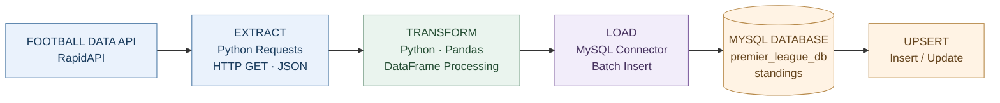

# Premier League Data Pipeline | Python, REST API & MySQL

An end-to-end **ETL pipeline** that extracts English Premier League standings from a REST API, transforms the data using Python and Pandas, and loads structured records into a MySQL database.

The project demonstrates practical implementation of API integration, data processing, SQL operations, database connectivity, and automated data updates through UPSERT logic.

## Architecture



## Technology Stack

| Category | Technologies |
|---|---|
| Programming | Python |
| API Integration | REST API, RapidAPI, Requests |
| Data Format | JSON |
| Data Processing | Pandas, DataFrames |
| Database | MySQL |
| Database Connectivity | MySQL Connector |
| Query Language | SQL |
| Configuration | Python-dotenv, Environment Variables |
| Development | Jupyter Notebook, VS Code |
| Version Control | Git, GitHub |

## Key Technical Implementations

### 1. REST API Integration & Extraction

- Integrated a football data REST API through RapidAPI.
- Used HTTP GET requests with configured headers and query parameters.
- Retrieved English Premier League standings using league ID `47`.
- Parsed nested JSON responses to extract team-level statistics.
- Implemented HTTP response validation using `raise_for_status()`.

**Skills:** REST APIs, HTTP methods, API authentication headers, query parameters, JSON parsing, response handling.

### 2. Data Transformation with Pandas

- Converted extracted JSON records into a Pandas DataFrame.
- Selected the relevant team performance attributes.
- Renamed raw API fields into meaningful column names.
- Structured the dataset into a consistent tabular format for database loading.

**Dataset:** 20 teams and 9 attributes.

| API Field | Transformed Column |
|---|---|
| idx | Position |
| name | Team |
| played | Played |
| wins | Won |
| draws | Drawn |
| losses | Lost |
| scoresStr | Goals |
| goalConDiff | Goal_Difference |
| pts | Points |

**Skills:** Pandas, DataFrame manipulation, column selection, schema mapping, data structuring.

### 3. MySQL Integration & Data Loading

- Established a MySQL database connection using `mysql.connector`.
- Used `executemany()` for batch insertion of multiple records.
- Implemented SQL UPSERT logic using `ON DUPLICATE KEY UPDATE`.
- Used `Position` as the primary key to identify existing records.
- Updated existing team statistics when a matching primary key was found.
- Used transaction `COMMIT` and `ROLLBACK` for database transaction handling.
- Implemented cursor and connection cleanup after execution.

**Skills:** MySQL, SQL INSERT, UPSERT, primary keys, batch processing, transactions, database connectivity.

### 4. Pipeline Structure & Configuration

- Organized the pipeline into reusable functions for extraction, transformation and loading.
- Used a main execution function to coordinate the complete workflow.
- Managed API and database credentials using environment variables.
- Used `python-dotenv` to load configuration from a `.env` file.
- Implemented exception handling and database resource cleanup.

**Skills:** Modular Python programming, exception handling, resource management, configuration management.

## Database Schema

**Database:** `premier_league_db`

**Table:** `standings`

| Column | Data Type | Description |
|---|---|---|
| Position | INT (Primary Key) | League position |
| Team | VARCHAR(100) | Team name |
| Played | INT | Matches played |
| Won | INT | Matches won |
| Drawn | INT | Matches drawn |
| Lost | INT | Matches lost |
| Goals | VARCHAR(10) | Goals scored and conceded |
| Goal_Difference | INT | Goal difference |
| Points | INT | Total points |

## Pipeline Output

Successfully retrieved, transformed and loaded all 20 Premier League team records into MySQL.

**Final MySQL Database Output**


*The screenshot displays the final standings table after pipeline execution and UPSERT.*

### SQL Verification

```sql
SELECT *
FROM premier_league_db.standings
ORDER BY Position;
```

## Project Structure

```text
API-SQL-integrating-project/
│
├── main.py
├── test.ipynb
├── requirements.txt
├── .gitignore
├── mysql_standings.png
└── README.md
```

| File | Description |
|---|---|
| `main.py` | Main ETL pipeline |
| `test.ipynb` | Jupyter notebook for exploration and testing |
| `requirements.txt` | Project dependencies |
| `.gitignore` | Excludes sensitive and unnecessary files |
| `mysql_standings.png` | Final MySQL output screenshot |

## Installation & Execution

### 1. Clone the repository

```bash
git clone https://github.com/tanushreejanbandhu18-blip/API-SQL-integrating-project.git

cd API-SQL-integrating-project
```

### 2. Install dependencies

```bash
pip install -r requirements.txt
```

### 3. Configure environment variables

Create a `.env` file in the project root:

```env
API_KEY=your_api_key
API_HOST=your_api_host

MYSQL_HOST=localhost
MYSQL_PORT=3306
MYSQL_USER=your_mysql_user
MYSQL_PASSWORD=your_mysql_password
MYSQL_DATABASE=premier_league_db
```

Replace the placeholders with your own credentials. Never upload `.env` to GitHub.

### 4. Run the pipeline

Ensure MySQL is running and the database and `standings` table have been created.

```bash
python main.py
```

## Key Outcomes

- Integrated an external REST API into a Python-based ETL workflow.
- Processed 20 Premier League teams into a structured 9-column dataset.
- Implemented batch loading using MySQL Connector.
- Applied SQL UPSERT logic to support record insertion and updates.
- Managed database transactions and connection resources.
- Separated credentials from application code using environment variables.

## Future Enhancements

- Schedule automated pipeline execution.
- Introduce additional data quality checks and validation.
- Maintain historical league standings for trend analysis.
- Extend the pipeline to incorporate additional football statistics.

---

**Technologies:** Python · REST API · Pandas · SQL · MySQL · Git · GitHub
